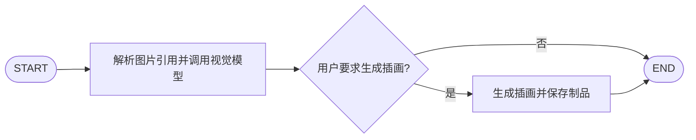

# 多模态工作流

用户上传门店照片后，工作流先用视觉模型生成招牌描述。只有明确请求插画时才调用图像生成模型，随后把生成文件存入应用并返回制品 ID。若要加审批、批量处理或图像质检，可以把它们放在对应模型调用之间。



## 运行仓库示例

按 [图文工作流的启动与调用步骤](../../multimodality.md#run-image-workflows) 运行示例，在页面选择 Graph Core 或提交 `POST /api/workflows/graph`。示例从上传文件生成临时引用。`inspect` 节点从引用加载原图并调用百炼视觉模型。`illustrate` 节点根据观察结果生成图片，转存后把制品 ID 写入图状态。设置 `createIllustration=false` 可验证从 `inspect` 直接退出的分支。

HTTP 示例为每次请求分配独立的运行 ID，并关闭 checkpoint saver。若要在多次请求间暂停与恢复，可按下文配置 saver，并将输入媒体保留到工作流结束。

## 将媒体解析放进模型节点

使用 [2.1.x BOM](/docs/versions)，引入 `com.alibaba.cloud.ai:spring-ai-alibaba-graph-core` 和提供 `ChatModel`、`ImageModel` 的 Starter。可使用 [百炼 Starter 和聊天配置](../../agent-framework/tutorials/multimodality.md#直接传入图像与文字)及 [图像模型配置](/integration/multimodals/image/dashscope-image)。

示例把 `inputAssetId`、描述和 `illustrationId` 放入图状态。`loadImage` 是应用实现的解析函数，根据 ID、当前授权和模型输入要求返回 Spring AI `Media`。`saveIllustration` 将图像结果转存到应用，返回稳定制品 ID。请在应用入口验证上传类型和大小，并为解析函数绑定可信的租户上下文。

```java
import java.util.Map;
import java.util.function.Function;

import com.alibaba.cloud.ai.graph.CompileConfig;
import com.alibaba.cloud.ai.graph.CompiledGraph;
import com.alibaba.cloud.ai.graph.StateGraph;
import com.alibaba.cloud.ai.graph.checkpoint.BaseCheckpointSaver;
import com.alibaba.cloud.ai.graph.checkpoint.config.SaverConfig;
import com.alibaba.cloud.ai.graph.exception.GraphStateException;
import org.springframework.ai.chat.messages.UserMessage;
import org.springframework.ai.chat.model.ChatModel;
import org.springframework.ai.chat.prompt.Prompt;
import org.springframework.ai.content.Media;
import org.springframework.ai.image.Image;
import org.springframework.ai.image.ImageModel;
import org.springframework.ai.image.ImagePrompt;

import static com.alibaba.cloud.ai.graph.StateGraph.END;
import static com.alibaba.cloud.ai.graph.StateGraph.START;
import static com.alibaba.cloud.ai.graph.action.AsyncEdgeAction.edge_async;
import static com.alibaba.cloud.ai.graph.action.AsyncNodeAction.node_async;

static CompiledGraph storefrontGraph(ChatModel visionModel, ImageModel imageModel,
        Function<String, Media> loadImage, Function<Image, String> saveIllustration,
        BaseCheckpointSaver saver) throws GraphStateException {
    return new StateGraph()
        .addNode("inspect", node_async(state -> {
            String assetId = state.value("inputAssetId", String.class).orElseThrow();
            var request = UserMessage.builder()
                .text("描述门店招牌的配色和构图。只记录图片中可见的事实。")
                .media(loadImage.apply(assetId))
                .build();
            var generation = visionModel.call(new Prompt(request)).getResult();
            String description = generation == null ? null : generation.getOutput().getText();
            if (description == null || description.isBlank()) {
                throw new IllegalStateException("Vision model returned no description");
            }
            return Map.of("description", description);
        }))
        .addNode("illustrate", node_async(state -> {
            String description = state.value("description", String.class).orElseThrow();
            var request = new ImagePrompt("根据以下描述的配色与构图生成一张门店插画：\n" + description);
            var generation = imageModel.call(request).getResult();
            if (generation == null) {
                throw new IllegalStateException("Image model returned no generation");
            }
            return Map.of("illustrationId", saveIllustration.apply(generation.getOutput()));
        }))
        .addEdge(START, "inspect")
        .addConditionalEdges("inspect", edge_async(state ->
            state.value("createIllustration", Boolean.class).orElse(false) ? "illustrate" : "finish"),
            Map.of("illustrate", "illustrate", "finish", END))
        .addEdge("illustrate", END)
        .compile(CompileConfig.builder()
            .saverConfig(SaverConfig.builder().register(saver).build())
            .build());
}
```

每个工作流实例使用独立的 `threadId`。示例用 `MemorySaver` 在同一进程中试运行。跨进程恢复时换成配置好的持久化 saver，复用工作流实例的 `threadId`。这个示例将描述与稳定 ID 放入 checkpoint。若应用还需要完整对话，可以将 `AssistantMessage` 整体放入独立状态键，或给 `messages` 配置追加策略并写入完整消息。

```java
import java.util.Map;

import com.alibaba.cloud.ai.graph.RunnableConfig;
import com.alibaba.cloud.ai.graph.checkpoint.savers.MemorySaver;

var graph = storefrontGraph(visionModel, imageModel, loadImage, saveIllustration, new MemorySaver());
var config = RunnableConfig.builder().threadId("storefront-job-42").build();
var state = graph.invoke(Map.of("inputAssetId", "storefront-photo-42", "createIllustration", true), config)
    .orElseThrow();
String description = state.value("description", String.class).orElseThrow();
var illustrationId = state.value("illustrationId", String.class);
```

生成文件写入完成后再返回制品 ID。若生成后、checkpoint 提交前发生故障，恢复可能重跑节点。业务应以稳定任务键查找既有制品，有外部任务 ID 时应优先查询原任务。前端只在授权后用制品 ID 获取展示地址。[持久化与恢复](../core/persistence.md) · [人工审批](human-in-the-loop.md)

## 使用内置 LlmNode

应用已持有 `List<Message>` 时，可使用 `com.alibaba.cloud.ai:spring-ai-alibaba-starter-builtin-nodes` 中的 `LlmNode`。将含 `Media` 的 `UserMessage` 放入 `messagesKey` 指定的状态键。`LlmNode` 会把消息列表传给 `ChatClient`，非流式完成时可从 `outputKey` 读取 `AssistantMessage`。如果应用需要让模型异常进入工作流的失败分支，可使用上面的自定义节点控制异常语义。

```java
import com.alibaba.cloud.ai.graph.node.LlmNode;
import org.springframework.ai.chat.client.ChatClient;

var visionNode = LlmNode.builder()
    .chatClient(ChatClient.create(visionModel))
    .messagesKey("visionMessages")
    .outputKey("visionReply")
    .build();
```

若选定的聊天模型能直接生成音频或图片，可从 `visionReply` 或其他模型节点的输出读取 `AssistantMessage.getParts()`。需要跨运行交付时，保存媒体字节或提供商允许下载的结果，再把应用制品 ID 写入状态。若只需要精确控制音色、文件格式或分辨率，在 Graph 中增加独立的语音合成、图像编辑或视频生成节点。[聊天模型媒体输出](../../agent-framework/tutorials/multimodality.md#直接接收聊天模型产生的媒体)

## 向模型回传工具媒体 {#rich-tool-result}

仅当模型和 Spring AI 适配器都接受原生媒体工具结果时，才把 `MediaPart` 放进 `ToolResultPart`。模型发起的原始 `AssistantMessage` 和工具结果需依次出现在下一次请求里。每个结果用对应工具的调用 ID，包含并行调用时按适配器协议完成整个批次再进入下一模型步。

```java
import java.util.List;
import java.util.Map;

import org.springframework.ai.chat.messages.AssistantMessage;
import org.springframework.ai.chat.messages.ToolResponseMessage;
import org.springframework.ai.chat.messages.part.MediaPart;
import org.springframework.ai.chat.messages.part.TextPart;
import org.springframework.ai.chat.messages.part.ToolResultPart;
import org.springframework.ai.content.Media;

static ToolResponseMessage screenshotResult(AssistantMessage.ToolCall call, Media screenshot) {
    return ToolResponseMessage.builder()
        .result(new ToolResultPart(call.id(), call.name(),
            List.of(TextPart.of("已生成预览图。"), MediaPart.of(screenshot)), false, null, Map.of()))
        .build();
}
```

上例构造 Spring AI 消息。Graph 内置 `ToolNode` 通过 `ToolCallback` 收集字符串结果，需自定义节点来生成这类有序工具消息。当前常用适配器对这类工具消息的支持见 [工具结果契约](../../multimodality.md#工具结果的两种去向)。使用 DashScope 时，可以在工具之后添加视觉质检节点，用媒体请求单独识图，然后向主模型返回检查结论和制品 ID。这样质检步骤使用了实际图片，应用也独立掌控审批和失败路径。

## 将工作流扩展到其他模态

| 场景 | 节点顺序与状态约定 |
| --- | --- |
| 录音问答 | 解析文件引用 → ASR → 文本问答 → 可选 TTS。状态保存转录、时间戳和语音制品 ID |
| 视频理解 | 按模型要求传视频 URL 或受控采样取帧 → 视觉分析。状态保存时间范围和分析结果，附加 ASR 可补足语音证据 |
| 长视频生成 | 提交任务 → 保存提供商任务 ID → 有界轮询或业务回调 → 转存视频。可对失败和超时添加单独分支 |
| PDF 问答 | 提取文本和页码 → 检索候选页 → 将必要页的截图或 PDF 片段送到支持它的模型。状态保存文档 ID 和引用页码 |
| 跨模态检索 | 使用多模态嵌入检索 → 解析召回的图片或片段 → 构造生成请求。状态保存命中条目与证据引用 |

并行节点可以分别生成字幕、封面图和语音。为不同产物使用独立状态键。共享列表时声明合并策略，并用制品或任务 ID 去重。有审核和重试的节点在状态中保存可追踪的失败原因，保留已成功产物供恢复使用。[并行分支](parallel-branch.md) · [长任务](long-time-running-task.md)

需要流式显示理解结果时，使用 [Spring AI LLM 流式示例](llm-streaming-springai.md)中的节点模式，完整响应聚合后再持久化。音视频作业的进度和制品就绪状态可以通过应用事件发送。客户端断线重连时从最终状态按 ID 补读。文件下载与播放使用媒体服务或选定模型的实时协议。

由模型动态决定生成或质检步骤时，参阅 [多模态 Agent](../../agent-framework/tutorials/multimodality.md)。两种模式的版本和框架设计见 [多模态架构与选型](../../multimodality.md)。
