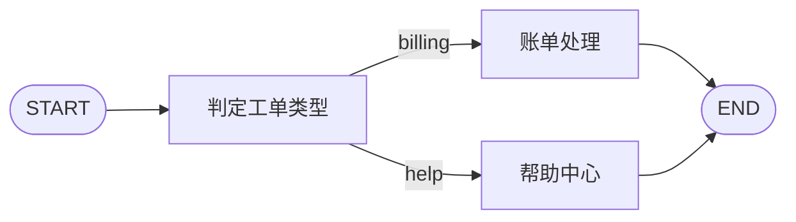

# Graph 工作流编排指南

本页用一个客服工单演示如何构建和运行 `StateGraph`。输入「我需要退款」时，图先判断工单类型，再进入账单分支。整个示例只需要 JDK 17+ 和 Maven。

## 添加依赖

在 Maven 项目中加入 `com.alibaba.cloud.ai:spring-ai-alibaba-graph-core`。如果已经导入 Spring AI Alibaba BOM，依赖可以省略版本。

```xml
<dependency>
    <groupId>com.alibaba.cloud.ai</groupId>
    <artifactId>spring-ai-alibaba-graph-core</artifactId>
    <version>2.1.0.0</version>
</dependency>
```

## 定义状态和路由

节点接收 `OverAllState`，返回本次要写入的键值。示例用 `AppendStrategy` 累积 `steps`，并用 `route` 选择后续节点。条件函数返回映射中的路由键。每个正常完成的分支都连到 `END`。



```java title="QuickStartExample.java"
public static CompiledGraph createTicketGraph() throws GraphStateException {
	return new StateGraph(() -> Map.of("steps", new AppendStrategy()))
			.addNode("classify", node_async(state -> {
				String request = state.value("request", String.class).orElseThrow();
				String route = request.contains("退款") ? "billing" : "help";
				return Map.of("route", route, "steps", List.of("classify"));
			}))
			.addNode("billing", node_async(state -> Map.of("reply", "已转账单处理", "steps", List.of("billing"))))
			.addNode("help", node_async(state -> Map.of("reply", "请查看帮助中心", "steps", List.of("help"))))
			.addEdge(START, "classify")
			.addConditionalEdges("classify", edge_async(state -> state.value("route", String.class).orElseThrow()),
					Map.of("billing", "billing", "help", "help"))
			.addEdge("billing", END)
			.addEdge("help", END)
			.compile();
}
```

[示例源码](https://github.com/alibaba/spring-ai-alibaba/blob/main/examples/documentation/src/main/java/com/alibaba/cloud/ai/examples/documentation/graph/QuickStartExample.java)

## 运行仓库示例 {#run-the-example}

从 Spring AI Alibaba 仓库根目录执行以下命令。其他 Graph Core 示例也可以复用生成的类路径。

```bash
mvn -q -f examples/documentation/pom.xml test-compile dependency:build-classpath \
  -Dmdep.outputFile=target/graph-example-classpath.txt

example_cp="examples/documentation/target/classes:$(cat examples/documentation/target/graph-example-classpath.txt)"
java -cp "$example_cp" com.alibaba.cloud.ai.examples.documentation.graph.QuickStartExample
```

预期日志包含 `steps=[classify, billing]` 和 `reply=已转账单处理`。把 `request` 换成普通咨询，执行路径会变为 `[classify, help]`。

各实战页标注的入口类位于 `com.alibaba.cloud.ai.examples.documentation.graph.examples`。例如，可以复用同一类路径运行 `java -cp "$example_cp" com.alibaba.cloud.ai.examples.documentation.graph.examples.CancellationExample`。核心概念页给出的入口类位于 `com.alibaba.cloud.ai.examples.documentation.graph.core`。

`compile()` 生成可复用的 `CompiledGraph`。用 `invoke` 读取执行结果，用 `stream` 观察执行过程。业务状态需要随会话保存时，为图配置检查点器并为每个会话指定 `threadId`。

## 用模型扩展邮件处理

完整示例还提供 `createEmailAgentGraph(ChatModel)`。它用模型分类和起草回复，在人工审核节点前暂停。配置 `AI_DASHSCOPE_API_KEY` 后可给同一启动命令追加 `--live`。示例的发送节点只记录结果。需要接入真实发送服务时，在审核通过后调用发送接口并为请求设置幂等键。[邮件工作流源码](https://github.com/alibaba/spring-ai-alibaba/blob/main/examples/documentation/src/main/java/com/alibaba/cloud/ai/examples/documentation/graph/QuickStartExample.java)

## 下一步

- [核心概念](core/core-library.md) 解释状态写入、路由和序列化。
- [持久化](core/persistence.md) 解释新一轮执行、恢复及检查点查询。
- [流式输出](core/streaming.md)、[并行节点](examples/parallel-branch.md) 和 [子图](examples/subgraph.md) 介绍常用的编排方式。
- [条件循环与迭代修订](examples/review-loop.md) 演示条件边如何同时更新状态、选择路由，并在达到业务上限时退出。
- [排查问题](troubleshooting.md) 汇总编译、恢复和流式消费中的常见问题。
