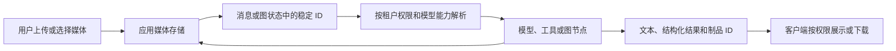

# 多模态架构与选型

当模型需要自己决定是否看图、读文件、生成图片或调用多个工具时，使用 [Agent Framework 多模态指南](agent-framework/tutorials/multimodality.md)。当业务需要明确控制转录、识别、审核、生成、重试和恢复的顺序时，使用 [Graph Core 多模态工作流](graph-core/examples/multimodal-workflow.md)。两种方式共用 Spring AI 消息、模型适配器及应用的媒体文件存储。

## 运行图文工作流 {#run-image-workflows}

Spring AI Alibaba 源码中的 `examples/multimodal` 提供两条可运行的示例。设置 `AI_DASHSCOPE_API_KEY`，在源码根目录启动应用。

```bash
./mvnw -f examples/multimodal/pom.xml spring-boot:run
```

打开 `http://localhost:8080/`，在「图文理解与插画生成」中上传 PNG 或 JPEG，选择 Agent Framework 或 Graph Core。命令行可以提交同样的表单，把 `mode` 改为 `graph` 即可切换编排。

```bash
mode=agent
curl --fail-with-body --silent --show-error \
  -F 'image=@examples/multimodal/src/main/resources/images/sample.png' \
  -F 'question=描述图片中的主要物体和颜色。' \
  -F 'createIllustration=true' \
  "http://localhost:8080/api/workflows/$mode" > workflow.json

curl --fail-with-body --silent --show-error \
  "http://localhost:8080$(jq -r '.artifacts[0].url' workflow.json)" -o illustration
```

两条路径默认使用 `qwen4-max` 理解图文，调用 `qwen-image-3.0-pro` 生成一张插画。响应包含 `observation` 与 `artifacts`。每个制品包含 `id`、`mimeType`、`sizeBytes` 和应用提供的 `url`，可从 `GET /api/artifacts/{id}` 预览或下载。设置 `createIllustration=false` 可以只看图，`artifacts` 会是空数组。[百炼视觉模型](https://www.alibabacloud.com/help/en/model-studio/text-generation-model) · [百炼图像生成模型](https://www.alibabacloud.com/help/en/model-studio/image-model)

可用 `DASHSCOPE_VISION_MODEL` 和 `DASHSCOPE_ILLUSTRATION_MODEL` 覆盖默认值。Agent 的聊天模型需同时接受图片和函数调用，图像模型需支持同步 `b64_json`。示例中的独立语音合成使用 `qwen-audio-3.1-tts-plus`，可通过 `DASHSCOPE_TTS_MODEL` 覆盖。[百炼语音合成](https://www.alibabacloud.com/help/en/model-studio/tts-model/)

用 `MULTIMODAL_ARTIFACT_DIRECTORY` 指定本地存储目录。Graph 运行时只把上传图片的 ID 放入状态，在读取节点解析，上传临时文件在请求结束后清理。生成图片保留在存储目录。示例在单个 HTTP 请求内完成，面向本地体验。生产场景可将存储换为带访问控制的对象存储。

### 百炼实测 {#live-dashscope-verification}

使用 Spring AI Alibaba 2.1.0.0 和 Extensions 2.1.0.0，向两条 HTTP 路径上传同一张测试图片并询问物体、颜色和位置。`qwen4-max` 在两条路径都识别出白底上的左侧红圆和右侧蓝方块。`qwen-image-3.0-pro` 分别生成了可解码的 PNG。

| 编排 | 生成路径 | 本次下载结果 |
| --- | --- | --- |
| Agent Framework | `generate_illustration` 工具生成并保存文件 | 2,528 × 1,696，1,908,824 字节 |
| Graph Core | `inspect` 后按条件进入 `illustrate` | 2,752 × 1,536，1,628,979 字节 |

两个下载接口均返回 HTTP 200 和 `image/png`，响应字节与应用存储中的文件一致。使用原存储目录重启应用后，同一制品路径仍返回相同的图片。在生成后继续以 `createIllustration=false` 调用两个入口，均返回视觉观察与空制品列表。

独立的 `POST /api/audio/tts` 使用 `qwen-audio-3.1-tts-plus` 实测中文合成，省略 `voice` 时返回可解码的 24 kHz 单声道 MP3。

## 选择模型与编排方式

| 需求 | 选择 | 编程入口 |
| --- | --- | --- |
| 直接理解图片、录音、视频或文档 | 在推理步骤中使用接受对应媒体的聊天模型 | `UserMessage` + `Media`，交给 `ReactAgent` 或 Graph 的模型节点 |
| 多轮任务中动态选择识图、读文件、生成等能力 | 注册工具，由 Agent 决定何时调用 | `ReactAgent` + `ToolCallback` 或 `@Tool`。工具也可调用另一个多模态模型 |
| 转录后审核、读图后生成图片、生成后再做质检 | 将专用模型和检查步骤拆成显式节点 | `StateGraph` + `NodeAction` + 条件边 |
| 由聊天模型直接生成带媒体的回答 | 按模型和适配器配置原生输出 | 从最终 `AssistantMessage.getParts()` 或 `getMedia()` 读取实际返回的媒体 |
| 必须生成指定格式、音色或分辨率的媒体 | 调用图像、语音或视频专用模型 | 由工具或 Graph 节点执行，向应用返回文件或媒体引用 |
| 实时双向语音或音视频会话 | 用适配器的实时会话处理连续媒体 | 在转写定稿、工具调用、业务确认等轮次边界调用 Agent 或 Graph |

### Spring AI 和 Extensions 提供的能力

以下能力以 [2.1.x 版本线](/docs/versions)为基线。选择模型时同时检查**提供商、模型版本、API 路径和调用模式**。能接收图片、能发起工具调用、能接收工具返回的图片、能返回图片或音频是四项独立能力。

| 能力 | 可用接口与适配 | 编排层需要关注 |
| --- | --- | --- |
| 图片、音频、视频理解 | Spring AI `ChatModel`。Extensions `DashScopeChatModel` 和 `DashScopeSdkChatModel` 提供多模态对话路径 | 核对 MIME、可访问 URL 或字节、视频文件或帧序列、数量和大小，以及是否支持与所需工具能力组合 |
| PDF、PPT 等文档理解 | 支持相应文档类型的 Spring AI 聊天适配器，或文档解析器与 OCR | DashScope 聊天适配器的通用媒体映射覆盖图片、音频、视频。使用 PDF 前确认选定适配器可直接提交 PDF，或先抽取文本、渲染必要页面 |
| 聊天模型原生媒体输出 | Spring AI 2.1 的 `AssistantMessage` 可包含 `MediaPart`。例如 `OpenAiChatModel` 会将已配置且实际返回的音频解码为媒体 | 逐模型验证同步、流式、下一轮回放。DashScope 适配器有响应媒体块解码路径，具体 Omni 参数及分块音频协议仍需验证 |
| 图片生成与编辑 | Spring AI `ImageModel`，Extensions `DashScopeImageModel`，另有 SDK 图像适配 | 将 URL 或 Base64 转成应用的制品引用。编辑用模型定义的参考图选项 |
| 语音识别与合成 | `DashScopeAudioTranscriptionModel`、`DashScopeAudioSpeechModel`，另有 SDK 适配 | 区分整文件、流式转写、流式合成与实时双向会话，按实际编码播放、存储和拼接 |
| 视频生成 | Extensions `DashScopeVideoModel` / `VideoModel` | `DashScopeVideoModel.call` 封装了提交和轮询，适合有明确等待上限的调用。需要跨进程恢复时，将任务提交与查询拆开并持久化任务 ID |
| 多模态检索 | `DashScopeMultimodalEmbeddingModel` + 可用的向量存储 | 向量用于召回。带原始媒体引用或带页码、时间戳的证据回到生成节点 |

[Spring AI Multimodality API](https://docs.spring.io/spring-ai/reference/api/multimodality.html) · [Spring AI 2.1 OpenAI 聊天适配器](https://github.com/spring-projects/spring-ai/blob/v2.1.0/models/spring-ai-openai/src/main/java/org/springframework/ai/openai/OpenAiChatModel.java) · [百炼模型接入](/integration/multimodals/dashscope-multimodal) · [百炼文本生成与视觉理解](https://www.alibabacloud.com/help/en/model-studio/text-generation-model) · [百炼 Omni 实时协议](https://www.alibabacloud.com/help/en/model-studio/omni-realtime-api)

## 消息与媒体文件

Spring AI 的 [Message Parts](agent-framework/tutorials/messages.md) 描述模型收到或产生的内容。构造请求时用 `Media` 携带 MIME 类型和数据。需要保留文本、媒体、工具调用的相对顺序时使用 `getParts()`。修改历史用 `mutate()`，保留模型回放所需的属性、签名和未知部分。

业务状态可以只持久化原始文件或生成制品的**稳定 ID**。实际文件存对象存储或应用文件服务。模型节点调用前，应用用 ID 和当前租户权限解析媒体，按适配器要求创建 `Media`。客户端通过应用控制的下载地址访问同一制品。模型可获取的 URL 与浏览器可访问的 URL 可以不同，并由各自的访问策略生成。



可在应用中用 `id`、`mimeType`、`sizeBytes`、`displayName` 表示持久引用，并按场景附加页码、时间范围或来源。存储归属、内部路径和签名密钥留在服务端。小型、短时请求可直接用 `Resource` 或字节。大文件、跨轮复用和可恢复工作流应在入口完成存储。媒体获取失败时返回明确状态，只有业务配置了替代路径时才继续执行，例如转写后改用文本模型。

在入口校验实际文件类型，为图片像素、音视频时长和解码后的数据设置限额。工具接收应用分配的制品 ID。确实允许远程地址时，限制可访问的来源，并在重定向后再次检查。为上传文件和生成文件定义保留期限，让对象存储的保留期覆盖需要恢复的窗口。日志只记录制品 ID、MIME、大小、延时和错误状态，便于追踪而无需记录字节或签名地址。

## 工具结果的两种去向

| 去向 | 数据约定 | 当前用法 |
| --- | --- | --- |
| 给应用或用户展示 | 持久制品 ID、MIME 类型、可选描述。展示时签发访问地址 | Agent 从工具消息读取 JSON 或用应用状态保存制品引用。Graph 节点直接返回制品引用 |
| 供下一次模型推理 | 对应工具调用 ID 的 `ToolResultPart`，文本与媒体按顺序放入 `content` | Graph 自定义节点可以构造该消息，发送前确认模型及适配器支持。普通 Agent `ToolCallback` 返回字符串 |

`ToolMultimodalResult` 配合 `MultimodalToolCallResultConverter` 返回的是 JSON 文本。JSON 里的图片 URL 可供应用解析和展示，模型收到的是 URL 字符串。当前 DashScope 聊天适配器的工具消息只接受文本，直接发送带 `MediaPart` 的工具结果会报错。需要让模型看到工具产物时，可在工具内部或下游 Graph 节点另行发起一次带媒体的 `UserMessage` 识别请求，再把观察结果写入工具响应或图状态。

检查工具媒体支持时要看适配器如何写出工具消息。Spring AI 2.1.0 的 OpenAI Chat Completions、Anthropic 和 Google GenAI 聊天适配器都从 `getResponses()` 读取旧式文本视图，该视图会丢弃嵌套媒体。只有适配器实际编码 `getResults()` 中的媒体并通过端点测试，才可使用原生工具媒体路径。[OpenAI 实现](https://github.com/spring-projects/spring-ai/blob/v2.1.0/models/spring-ai-openai/src/main/java/org/springframework/ai/openai/OpenAiChatModel.java) · [Anthropic 实现](https://github.com/spring-projects/spring-ai/blob/v2.1.0/models/spring-ai-anthropic/src/main/java/org/springframework/ai/anthropic/AnthropicChatModel.java) · [Google GenAI 实现](https://github.com/spring-projects/spring-ai/blob/v2.1.0/models/spring-ai-google-genai/src/main/java/org/springframework/ai/google/genai/GoogleGenAiChatModel.java) · [DashScope 消息映射](https://github.com/spring-ai-alibaba/spring-ai-extensions/blob/v2.1.0.0/models/spring-ai-alibaba-dashscope/src/main/java/com/alibaba/cloud/ai/dashscope/chat/DashScopeMessageParts.java)

Deep Agents 将用户上传、工具发现媒体和工具交付文件组合在同一轮次中。其 `read_file` 可对特定文件返回媒体块，也可以抽取视频帧。长会话通过后端存储和引用保留原始文件。Spring AI Alibaba 当前的 `ReadFileTool` 是文本读取工具。类似用法可通过专门的 `inspect_media`、`transcribe_audio` 或 `read_document` 工具实现，并按调用关联记录文件来源。引入框架级媒体读取能力时，可将文件识别、抽帧和权限复用在同一服务中。[Deep Agents 多模态指南](https://docs.langchain.com/oss/python/deepagents/multimodal)

## 流式、历史与恢复

- **流式消费。** Agent/Graph 的 `StreamingOutput.message()` 可以携带消息，`chunk()` 提供文本片段。客户端若要展示媒体，应读取完整消息部分或制品通知，按提供商协议聚合增量后再保存最终消息。音频的实时播放需要匹配分帧、编码、背压与取消行为，单独使用模型的音频流或实时会话协议。
- **Checkpoint。** 2.1.x 的 Graph Spring AI 对象流和 Jackson 序列化器使用 `MessagePartsCodec` 保留有序部分，包括用户媒体、助手媒体与嵌套工具结果。媒体内容可序列化并不保证 URL 有效期、文件存续或其他消息仓库的兼容性。持久化时使用稳定引用，恢复时重新授权并解析。旧文本消息可继续使用。在升级或更换 saver、序列化器前，用真实历史验证旧数据回读以及新数据往返。
- **会话压缩。** 现有对话摘要主要以文本表达。把关键媒体的 ID、内容摘要和页码、帧号或时间戳保留在业务状态。需要再次感知原始媒体时，将它重新加入模型请求。保留工具调用与结果的一致性，按模型单独预算附件数量、像素、音频时长和视频帧数。
- **长任务。** 对生成视频这类外部作业，持久化提交状态和任务 ID。恢复后继续查询已知任务。使用业务幂等键及外部能力处理提交重试。外部服务不提供幂等提交时，记录结果未知的请求，并在重试前查证。取消等待与取消提供商任务分别记录。
- **前端与协议。** Spring AI 消息、Studio 的消息 DTO、SSE/WebSocket 与对象存储各有契约。Studio 已有消息 parts 的转换及图片、PDF 输入处理。音视频播放、工具制品通知、跨端恢复和签名续期按所用客户端验证。

[Graph 持久化](graph-core/core/persistence.md) · [Graph 流式输出](graph-core/core/streaming.md) · [Agent 上下文工程](agent-framework/advanced/context-engineering.md)

## 框架演进方案

这一节描述计划中的框架能力。两篇编程指南用 2.1.x 已有入口演示同一套数据流。

### 1. 统一媒体引用和模型能力声明

Spring AI 继续提供 `Media`、`MessagePart` 及模型接口，Extensions 维护各供应商的协议和能力映射。Graph/Agent 共用应用可扩展的媒体引用和解析契约。引用写入状态时只包含可持久化字段，解析时接收当前租户、用途和所需格式，返回短时地址或受限资源。先用字符串、列表和映射组成跨 saver 可序列化的值。若提供公共 Java 类型，同时定义版本化编码与旧状态读取方式。

在实际选定的模型和 API 路径上声明输入媒体类型及传输格式、助手输出类型、工具调用及工具结果支持、流式能力和组合限制。应用可覆写适配器默认声明。Graph 在节点调用前验证，Agent 在每次选模型或回退前验证当前轮历史。格式不兼容时报告所缺能力。只有配置了提取文本、抽帧或专用模型等替代路径时才执行降级。

解析接口应区分制品不存在、访问被拒、超出大小限制和模型不支持该格式。过期的已签名地址可重新授权生成。制品已删除或类型不兼容时，由 Graph 分支接收失败状态，或由 Agent 工具返回稳定错误码和面向模型的简短说明。模型回退时保留模型仍能理解的历史部分，对需要重新解析或转换的媒体按显式策略处理。

### 2. 打通 Agent 和 Graph 的工具结果

保留当前 `ToolCallback`、`@Tool` 转换器、`returnDirect` 和文本结果行为。新增可选的结构化执行入口，或优先复用 Spring AI 将来提供的对应扩展。工具返回有序结果部分和独立的制品引用。执行器从原始工具请求绑定调用 ID 和工具名，沿用现有错误标记、并行批次顺序、审批和恢复语义。先在 Agent 工具节点和可复用的 Graph 工具步骤接入，让两条路径共享消息格式。

按目标模型投影结果。支持原生媒体工具结果的适配器接收 `ToolResultPart`，只接受文本的适配器接收摘要和引用。需要感知媒体时，可配置独立的识别步骤，把观察结果返回给主模型。如果未来支持在工具消息之后追加合成观察消息，应先补齐该端点的角色顺序测试，再保留原始工具配对及应用生成的来源元数据。应用从单独的制品引用读取最终文件，保持工具或助手生成的资源与对应轮次关联。

### 3. 补齐节点、流式与恢复范式

Graph Core 保持通用状态机。先用可组合的 `NodeAction` 提供读取、理解、生成与保存模式，验证后再将通用节点放入内置节点 Starter。Agent 使用同一服务注册按需工具，包括读取授权附件、语音转录及生成。媒体进入 checkpoint 的时机、并行列表合并规则和失败恢复由图定义。解析后的资源只在当前访问步骤中使用。

文本增量沿用当前流式 API。媒体制品准备就绪时可发布带运行 ID、节点或工具调用 ID、制品 ID、MIME 和状态的事件，让 HTTP/Studio 用同一引用展示。客户端用事件 ID 去重，恢复时用已提交状态补齐通知。长任务单独发布进度，实时媒体使用专用传输。

### 交付顺序与验收

| 顺序 | 交付范围 | 验收条件 |
| --- | --- | --- |
| 1 | 图文输入与两种编排示例，应用侧制品交付 | 在线模型请求能看到实际图片。Agent 工具和 Graph 节点生成的制品可由应用读取。既有纯文本调用行为保持兼容 |
| 2 | 能力声明、媒体解析、原生工具结果和文本替代路径 | 验证模型收到正确 MIME、工具 ID 和有序媒体块。DashScope 文本工具路径可用。无可用替代步骤时给出明确失败 |
| 3 | 跨进程恢复、流式事件及更多模态 | 验证持久 saver 重启后续签，媒体过期、无权访问及压缩后重读，审批恢复时并行结果顺序和去重，以及长任务超时、取消与恢复 |

在适配器测试中覆盖请求序列化与响应聚合，在 Graph/Agent 契约测试中覆盖状态、角色和错误路径，再对每个公开支持的模型、端点和流式组合做真实调用验收。记录模型标识、端点和使用的依赖版本，便于复现兼容性问题。
